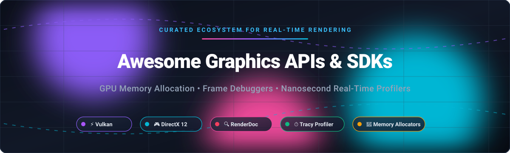

  

# 🚀 Awesome Graphics APIs & SDKs 

  
  
  
  
  
  

> 🎯 **Curated directory of top-tier Graphics APIs, SDKs, GPU Memory Allocators, Frame Debuggers, and Real-Time Profilers** for Vulkan, Direct3D 12, Metal, and OpenGL.

---

## 📌 Executive Summary & Key Highlights

This open-source collection tracks industry-leading **SaaS developer platforms** and **open-source infrastructure** for low-level computer graphics engineering. Modern explicit APIs like **Vulkan** and **Direct3D 12 (DirectX 12)** offer direct hardware access but place responsibility for GPU virtual memory management, synchronization barriers, and draw pipeline health on the programmer. 

Here you will find battle-tested tools essential for:
- ⚡ **GPU Virtual Memory Management & Custom Sub-allocation** (VMA, D3D12MA)
- 🔍 **Pixel-by-Pixel Frame Debugging & Shader Stepping** (RenderDoc, Nsight Graphics, PIX)
- ⏱️ **Nanosecond Frame Profiling, GPU Traces & Lock Contention** (Tracy Profiler, Superluminal)
- 🛠️ **Cross-Platform Abstraction & Shader Toolchains** (bgfx, sokol, DXC, glslang, SPIRV-Tools)

---

## 📑 Table of Contents

- [📊 Sector Overview & Market Dynamics](#-sector-overview--market-dynamics)
- [🏢 SaaS & Hosted Commercial Platforms](#-saas--hosted-commercial-platforms)
- [💻 Open-Source GitHub Projects](#-open-source-github-projects)
- [💡 Architectural Workflow: How to Combine These Tools](#-architectural-workflow-how-to-combine-these-tools)
- [🤝 How to Contribute](#-how-to-contribute)
- [💖 Support & Sponsorship](#-support--sponsorship)
- [📈 Star History](#-star-history)
- [📜 Disclaimer & Notes](#-disclaimer--notes)

---

## 📊 Sector Overview & Market Dynamics

The global graphics software and GPU developer tools ecosystem operates adjacent to a hardware and compute market valued at over **$130 billion** (projected to reach **$300B–$600B+** accelerated by real-time ray tracing, AAA game engines, and generative AI simulation workloads), with the dedicated computer graphics, profiling, and diagnostics software segment representing an estimated **$10B–$15B** market. 

The sector is **highly concentrated** around dominant hardware and operating system titans (**NVIDIA, Microsoft, AMD, and Intel**) who operate a near *winner-take-all* strategy: each provides proprietary, hardware-locked profiling suites for free to entrench adoption of their respective silicon architectures (CUDA, RDNA, Arc) and graphics standards (DirectX 12, Vulkan). Independent commercial vendors (such as **Superluminal**) carve out sustainable positions by delivering lightweight sampling performance with minimal friction across multi-core CPUs and gaming consoles, while community-led open-source tools (**RenderDoc, Tracy, VMA, bgfx**) serve as neutral, portable industry anchors.

---

## 🏢 SaaS & Hosted Commercial Platforms

| 🏢 Company | 🛠️ Platform / Tool | 💰 Valuation / Revenue | 🏷️ Pricing | 🎁 Free Tier Limits | 📖 Description |
| :--- | :--- | :--- | :--- | :--- | :--- |
| **NVIDIA** | [NVIDIA Nsight Graphics](https://developer.nvidia.com/nsight-graphics) | ~$5.2T Market Cap / ~$130B+ Rev | Free ($0) | Free forever (Full access to all features; restricted to NVIDIA hardware metrics and standard EULA terms) | NVIDIA's flagship graphics debugging and profiling suite. Provides frame capture, ray tracing debugging, GPU trace analysis, and shader profiling with deep hardware counters. |
| **Microsoft** | [PIX on Windows](https://devblogs.microsoft.com/pix/) | ~$3.9T Market Cap / ~$245B+ Rev | Free ($0) | Free forever (Full access to all features; Windows & DirectX 12 applications only) | Microsoft's premier performance tuning and debugging tool for DirectX 12. Direct D3D12 command list inspection, GPU capture, memory heap analysis, and timing captures. |
| **AMD** | [AMD Radeon GPU Profiler (RGP)](https://gpuopen.com/rgp/) | ~$890B Market Cap / ~$25B+ Rev | Free ($0) | Free forever (Full access to all features; RDNA/AMD architecture GPUs only) | AMD's hardware profiler for RDNA GPUs. Visualizes wave occupancy, instruction-level cache timing, hardware pipeline bottlenecks, and barrier stalls. |
| **Intel** | [Intel Graphics Performance Analyzers (GPA)](https://www.intel.com/content/www/us/en/developer/tools/graphics-performance-analyzers/overview.html) | ~$470B Market Cap / ~$54B+ Rev | Free ($0) | Free forever (Full access to all features; v2025.1 final release / community-supported) | Intel's suite for profiling and analyzing graphics workloads on Intel Arc and Iris GPUs, with baseline metrics on third-party hardware. |
| **Superluminal** | [Superluminal](https://superluminal.eu/) | Private (~$1M–$5M ARR est.) | €59 (Personal perpetual) / €289/seat/year (Business) | 14-day free trial (Full access to all features across Windows, Linux, Xbox, and PlayStation; no seat limit during trial) | Commercial high-performance sampling CPU/GPU profiler for Windows/consoles with exceptional context-switch and thread-migration analysis without code modification. |

---

## 💻 Open-Source GitHub Projects

The open-source graphics tooling landscape provides essential infrastructure for building custom game engines, rendering systems, and shader compilers. Below are the top open-source projects sorted descending by GitHub Stars_Count:

1. **[bgfx](https://github.com/bkaradzic/bgfx)**   
   Cross-platform, graphics API agnostic rendering library supporting Vulkan, Direct3D 11/12, Metal, OpenGL, and WebGPU. Designed for portability and game engine backends. **License:** BSD-2-Clause.

2. **[Tracy Profiler](https://github.com/wolfpld/tracy)**   
   Real-time, nanosecond-resolution frame profiler for CPU (C/C++, Rust, Zig) and GPU (Vulkan, D3D12, OpenGL, OpenCL). Streams live telemetry over sockets with microsecond lock contention, memory allocation tracking, and frame mark analysis. **License:** MIT.

3. **[RenderDoc](https://github.com/baldurk/renderdoc)**   
   The cross-platform standard for frame debugging across Vulkan, DirectX 11/12, OpenGL, and OpenGL ES. Allows deep pixel inspection, shader debugging, pipeline state analysis, and draw call event isolation on any vendor hardware. **License:** MIT.

4. **[sokol](https://github.com/floooh/sokol)**   
   Minimalist, header-only C cross-platform graphics wrapper (`sokol_gfx.h`) and application runtime for Vulkan, Metal, D3D11, and WebGL/WebGPU. Ideal for cross-platform tools and lean retro/modern engines. **License:** zlib.

5. **[DirectX-Graphics-Samples](https://github.com/microsoft/DirectX-Graphics-Samples)**   
   Official Microsoft Direct3D 12 and DirectX Raytracing (DXR) reference samples. Demonstrates state-of-the-art D3D12 architectures, work graphs, execute indirect, variable rate shading, and mesh shaders. **License:** MIT.

6. **[Vulkan-Samples](https://github.com/KhronosGroup/Vulkan-Samples)**   
   The official Khronos Group curated collection of Vulkan best practice samples. Covers pipeline barriers, descriptor indexing, render passes, ray tracing pipelines, and memory allocation strategies. **License:** Apache-2.0.

7. **[Orbit](https://github.com/google/orbit)**   
   Standalone application profiler by Google for Windows and Linux. Supports dynamic uprobe/kprobe style instrumentation and sampling of production binaries without recompiling target binaries. **License:** BSD-2-Clause.

8. **[DirectXShaderCompiler (DXC)](https://github.com/microsoft/DirectXShaderCompiler)**   
   LLVM/Clang-based compiler for modern High-Level Shader Language (HLSL) generating DXIL (DirectX Intermediate Language) and SPIR-V for Vulkan cross-compilation. **License:** Apache-2.0 with LLVM Exception.

9. **[glslang](https://github.com/KhronosGroup/glslang)**   
   Khronos reference front-end compiler and validator for GLSL, ESSL, and HLSL compiling into SPIR-V. The standard shader compilation step inside Vulkan toolchains and validation layers. **License:** BSD-3-Clause / Apache-2.0.

10. **[Vulkan Memory Allocator (VMA)](https://github.com/GPUOpen-LibrariesAndSDKs/VulkanMemoryAllocator)**   
    The de facto standard memory allocation library for Vulkan by AMD GPUOpen. Solves Vulkan's rigid allocation count limits by sub-allocating large memory blocks, handling defragmentation, alignment requirements, and custom pools. **License:** MIT.

11. **[Vulkan-Guide](https://github.com/KhronosGroup/Vulkan-Guide)**   
    Khronos Group's official comprehensive architectural guide for navigating the Vulkan ecosystem, covering best practices, synchronization models, and pipeline optimizations. **License:** CC-BY-4.0.

12. **[SPIRV-Tools](https://github.com/KhronosGroup/SPIRV-Tools)**   
    Official API and command-line tools for processing, optimizing, validating, assembling, and disassembling SPIR-V intermediate language modules. **License:** Apache-2.0.

13. **[D3D12 Memory Allocator (D3D12MA)](https://github.com/GPUOpen-LibrariesAndSDKs/D3D12MemoryAllocator)**   
    The Direct3D 12 equivalent of VMA from AMD GPUOpen. Provides `Allocator::CreateResource` as a direct drop-in replacement for `CreateCommittedResource`, automating heap tier management and custom memory pools. **License:** MIT.

14. **[DirectX-Headers](https://github.com/microsoft/DirectX-Headers)**   
    Official Microsoft repository providing DirectX 12 headers, Agility SDK runtime interfaces, and WSL (Windows Subsystem for Linux) D3D12 user-mode drivers. **License:** MIT.

15. **[Radeon GPU Profiler (RGP CLI/Tools)](https://github.com/GPUOpen-Tools/radeon_gpu_profiler)**   
    Open-source companion utilities and parser tools for analyzing Radeon Developer Tool Suite execution profiles on AMD hardware. **License:** MIT.

---

## 💡 Architectural Workflow: How to Combine These Tools

For engine developers and graphics programmers building on modern APIs:

1. **Memory Allocation**: Use **[VMA](https://github.com/GPUOpen-LibrariesAndSDKs/VulkanMemoryAllocator)** (Vulkan) or **[D3D12MA](https://github.com/GPUOpen-LibrariesAndSDKs/D3D12MemoryAllocator)** (DirectX 12) to handle virtual memory heaps and prevent driver allocation count exhausts.
2. **Shaders**: Author in HLSL using **[DXC](https://github.com/microsoft/DirectXShaderCompiler)** or GLSL via **[glslang](https://github.com/KhronosGroup/glslang)**, optimizing final binaries with **[SPIRV-Tools](https://github.com/KhronosGroup/SPIRV-Tools)**.
3. **Correctness & Frame Inspection**: Use **[RenderDoc](https://github.com/baldurk/renderdoc)** to inspect draw calls, blend states, and render target buffers independent of GPU vendor.
4. **Continuous CPU/GPU Profiling**: Embed **[Tracy](https://github.com/wolfpld/tracy)** zones in your frame loop to detect millisecond stalls, GPU queue timing, and synchronization bottlenecks.
5. **Hardware Bottleneck Deep-Dives**: When hardware limits (wave occupancy, register spills, texture cache misses) are reached, deploy vendor suites: **[Nsight](https://developer.nvidia.com/nsight-graphics)** (NVIDIA), **[RGP](https://gpuopen.com/rgp/)** (AMD), or **[PIX](https://devblogs.microsoft.com/pix/)** (DirectX/Windows).

---

## 🤝 How to Contribute

Contributions are welcome! To propose updates or add newly launched tools:

1. 🍴 Fork the repository.
2. 📝 Add or update entries in `README.md` adhering to the table or list formatting.
3. 🔎 Keep descriptions factual, objective, and provide official repository/site links.
4. 🚀 Submit a Pull Request with a clear title and description.

---

## 💖 Support & Sponsorship

If you find this curated graphics ecosystem directory valuable for your game development, engine engineering, or research projects, please consider supporting the project:

- ⭐ **Star this repository** to help others discover it on GitHub.
- 🍴 **Fork and share** with fellow graphics engineers, technical artists, and game development teams.
- ☕ **Sponsor & Buy a Coffee:** You can support continuous maintenance via the [GitHub Sponsor Dashboard](https://github.com/sponsors/ishandutta2007).

Thank you for your encouragement and support! 🙌

---

## 📈 Star History

---

## 📜 Disclaimer & Notes

- This repository is a community-curated list compiled for educational and professional utility; inclusion does not constitute commercial endorsement.
- **Vendor Tool Portability**: Hardware-specific profilers (Nsight, RGP, PIX) provide the deepest counter diagnostics on their respective silicon architectures, while RenderDoc and Tracy serve as the premier vendor-neutral standards.
- **Sampling vs. Instrumentation**: Sampling profilers (Superluminal, Orbit) require no source instrumentation; instrumentation profilers (Tracy) provide exact nanosecond timelines for designated execution zones. Using both delivers optimal optimization workflow.
